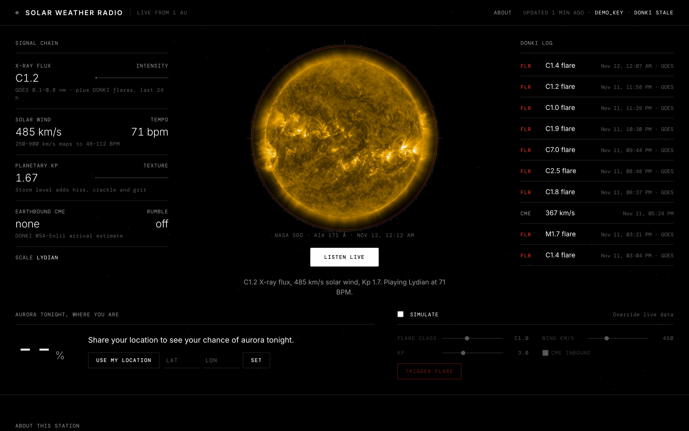

# Solar Weather Radio

**Listen live: [solar-weather-radio.kn-naresh.workers.dev](https://solar-weather-radio.kn-naresh.workers.dev)**

[](https://solar-weather-radio.kn-naresh.workers.dev)

A live, generative ambient soundtrack driven by the Sun. Solar flares, coronal mass ejections and
geomagnetic storms from NASA's [DONKI](https://api.nasa.gov) (plus NOAA SWPC real-time feeds) are
mapped to musical parameters and played with Tone.js. It also includes a "chance of aurora where you
are tonight" panel.

## Run it

```bash
npm install
cp .dev.vars.example .dev.vars   # paste your free key from https://api.nasa.gov
npm run dev                      # http://localhost:5173
```

It works without a key (`DEMO_KEY`), but that key allows only ~10 requests/hour, so DONKI is
fetched at most every 30 min. With your own key it refreshes every 10 min.

## Deploy to Cloudflare

The backend is a Cloudflare Worker ([src/worker.mjs](src/worker.mjs)); `public/` is served as
static assets.

```bash
npx wrangler login
npx wrangler deploy                       # creates the Worker and its KV namespace
npx wrangler secret put NASA_API_KEY      # paste your key when prompted
```

There is no polling loop. Each source is fetched on demand, kept in memory per isolate, and
refreshed in the background once stale, so only a cold start waits on NASA or NOAA. The
rate-limited DONKI data is also saved to KV so every isolate shares it.

## How the Sun becomes music

| Space weather                         | Source                         | Musical parameter                                                   |
| ------------------------------------- | ------------------------------ | ------------------------------------------------------------------- |
| X-ray flux / flare class (A→X)        | GOES live flux + DONKI `FLR`   | **Intensity**: pad brightness, bell density, FM harshness           |
| Flare class letter                    | same                           | **Scale**: B pentatonic, C lydian, M dorian, X phrygian             |
| New flare event                       | DONKI `FLR` / GOES event list  | One-shot riser + bell cascade + visual shockwave                    |
| Solar wind speed (250–900 km/s)       | NOAA RTSW (DSCOVR/ACE)         | **Tempo**: 48–112 BPM                                               |
| Solar wind density                    | NOAA RTSW                      | Reverb size, wind-hiss level                                        |
| Kp index / DONKI storms               | NOAA Kp + DONKI `GST`          | **Texture**: hiss, crackle, bit-crush, chorus depth                 |
| Earth-directed CME                    | DONKI `CME` (WSA-Enlil)        | **Rumble**: sub-bass swell until the estimated arrival               |

## Aurora panel

Uses NOAA's OVATION aurora model. The oval is fixed relative to the Sun, so "tonight" for you is
what the oval is doing *right now* over the midnight sector at your **geomagnetic** latitude.
That number is scaled by tonight's forecast Kp versus current Kp. Aurora up to ~10° poleward still
counts, because it's visible on the horizon. That gives the **aurora activity** number.

The headline number is the chance you'll actually **see** it. The Worker finds tonight's dark hours
(sun more than 12° below the horizon, computed locally), pulls hourly cloud cover for your spot
from [Open-Meteo](https://open-meteo.com) (free, no key, cached 30 min on a 0.1° grid), and
scales activity by how clear the sky is (60% average cloud over the dark hours, 40% the clearest
hour). The panel also shows the clearest hour, the dark window and the Kp you typically need.

## Design

Flat and monochrome in the style of NASA's own sites: black background, Inter and DM Mono type,
hairline rules and NASA red as the only accent. The Sun in the centre is the latest real image
from NASA's Solar Dynamics Observatory (AIA 171 Å), proxied and cached for 15 min by the Worker.
The ring around it is the live audio waveform.

## Demo mode

Tick **Simulate** to drive the engine with sliders and press **Trigger flare**, which is handy for
recording a portfolio video when the Sun is quiet.

## Notes

- DONKI's `FLR` endpoint was returning 404 as of Nov 2026, so flares fall back to NOAA's GOES flare
  list automatically (the log marks those `GOES`).
- The Worker has no runtime dependencies. Tone.js is copied from `node_modules` into
  `public/vendor/` by the build step in `wrangler.jsonc`.
